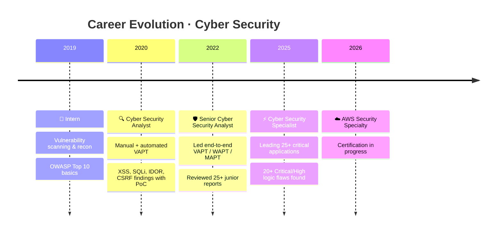

<!-- ═══════════ HEADER ═══════════ -->
<div align="center">


<a href="https://linkedin.com/in/vishal-chaudhari52"></a>

<br/>


<br/><br/>

<a href="mailto:vishal.chaudhari52@gmail.com"></a>
<a href="https://linkedin.com/in/vishal-chaudhari52"></a>


<br/><br/>

<a href="https://linkedin.com/in/vishal-chaudhari52"></a>

<br/>


</div>

## 🧠 `> whoami`

```bash
$ cat profile.txt
```

<div align="center">

| 🛡️ **ROLE** | 🎓 **EDUCATION** | 🏅 **CERTIFIED** |
|:---:|:---:|:---:|
| Cyber Security Specialist | B.E. Electronics & Telecommunication | CEH v8 · Info Security Consultant |

</div>

> Seasoned Cyber Security Specialist with hands-on experience **since July 2019** in application and network security testing, specializing in **WAPT, MAPT and Network VAPT**. Reviewed and tested **25+ critical applications** across enterprise web, mobile and cloud environments. Skilled at uncovering Critical/High business-logic vulnerabilities with **Burp Suite Pro** and **MobSF**, with strong technical reporting, remediation guidance and **AWS Security** (IAM, VPC, GuardDuty, S3, KMS).


## ⚡ `> ls ./skills`

<div align="center">

</div>

<div align="center">

### 🔴 Offensive Security


### 🛠️ Security Arsenal


### ☁️ Cloud Security


### 📚 Frameworks & Standards


### 💻 Scripting & Data


</div>


## 🚀 `> career --timeline`



<details open>
<summary><b>⚡ Cyber Security Specialist</b> &nbsp;·&nbsp; <code>June 2025 – Present</code></summary>
<br/>

- 🎯 Lead, review and test **25+ critical production web & mobile applications** through in-depth manual VAPT, WAPT and MAPT assessments.
- 🐞 Uncovered **20+ Critical/High-severity** business-logic flaws, IDORs and authentication bypasses, reducing exploit risk vectors across client infrastructures.
- 📝 Document findings and exploit paths using Burp Suite Pro, MobSF, Frida, ADB and Nmap.
- 🔁 Coordinate vulnerability retesting and track end-to-end remediation cycles to closure, validating fixes with development teams.
- 📐 Maintain and update internal testing checklists and methodologies aligned with OWASP, MITRE ATT&CK and CWE.

</details>

<details>
<summary><b>🛡️ Senior Cyber Security Analyst</b> &nbsp;·&nbsp; <code>April 2022 – May 2025</code></summary>
<br/>

- 🎯 Led end-to-end VAPT, WAPT and MAPT assessments for enterprise clients across **finance, e-commerce and technology** sectors.
- 🐞 Detected logic flaws, IDOR, broken access control and mobile vulnerabilities; authored functionality-based test cases and checklists.
- ✅ Reviewed and quality-validated **25+ security reports** from junior analysts, delivering actionable impact ratings and remediation guidance.

</details>

<details>
<summary><b>🔍 Cyber Security Analyst</b> &nbsp;·&nbsp; <code>January 2020 – March 2022</code></summary>
<br/>

- ⚙️ Executed manual and automated VAPT for web and mobile apps using Burp Suite Pro, MobSF, ADB, Frida and OWASP ZAP.
- 🐞 Discovered and documented critical vulnerabilities (**XSS, SQL Injection, IDOR, CSRF, Broken Authentication, Insecure Storage**) with PoC steps.
- 📊 Prepared structured technical reports with severity ratings to drive executive and engineering remediation decisions.
- 🤝 Collaborated with developers to explain findings and verify fixes through retesting.

</details>

<details>
<summary><b>🌱 Intern</b> &nbsp;·&nbsp; <code>July 2019 – December 2019</code></summary>
<br/>

- 🔎 Performed initial vulnerability scanning and reconnaissance on web apps using Burp Suite (Community), Nmap and MobSF.
- 📋 Conducted basic OWASP Top 10 assessments to detect common web weaknesses.
- 📝 Documented findings and created remediation notes for senior engineers.

</details>


## 🏆 `> cat achievements.log`

<div align="center">

| 🏅 Hall of Fame | Details |
|:---:|:---|
| **#1** | Identified a **missing SPF record** enabling potential email spoofing; reported via responsible disclosure, significantly reducing phishing risk for the vendor. |
| **#2** | Discovered and responsibly disclosed a **critical web-platform vulnerability**; coordinated remediation directly with vendor engineering to improve security posture. |

</div>

## 📜 `> certifications --list`

<div align="center">


</div>

## 🎓 `> education --history`

| Degree | Board / University | Score | Year |
|:---|:---|:---:|:---:|
| **B.E. Electronics & Telecommunication** | North Maharashtra University (NMU), Jalgaon | 2017 |
| HSC (12th) | Maharashtra State Board | 2012 |
| SSC (10th) | Maharashtra State Board | 2010 |


<div align="center">

```text
┌──────────────────────────────────────────────────────────┐
│  "Every system has a weakness — my job is to find it     │
│   before someone else does."                             │
└──────────────────────────────────────────────────────────┘
```


</div>
